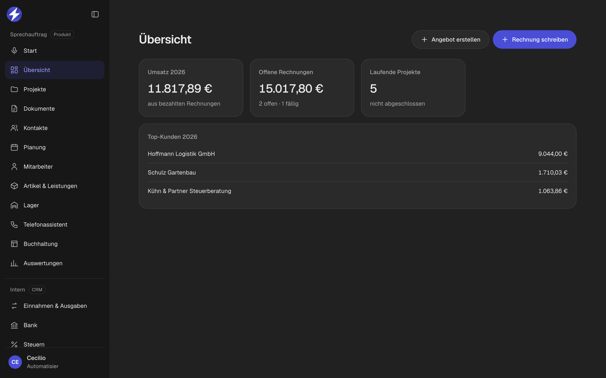
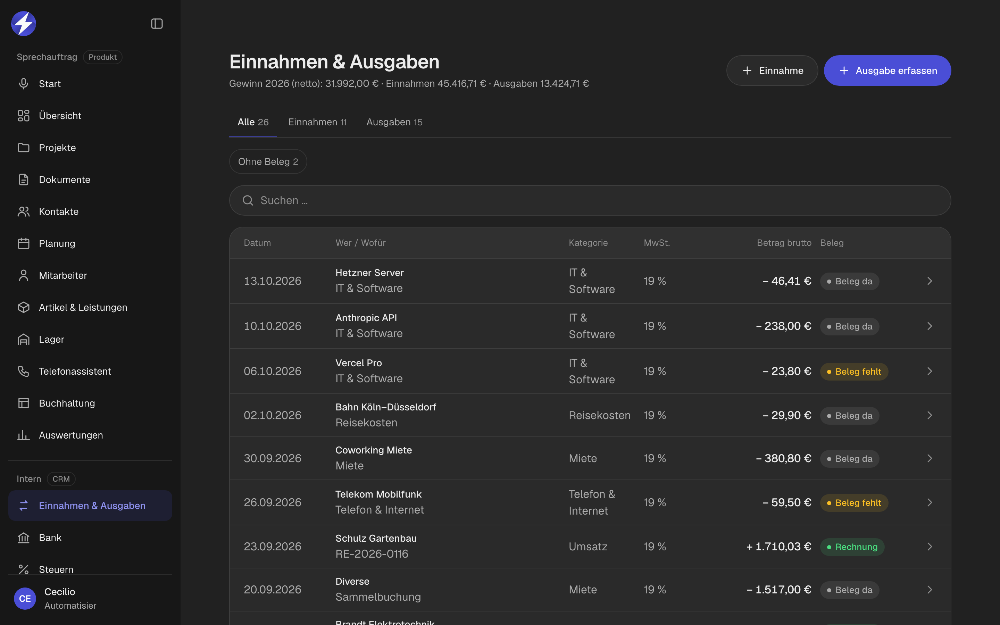
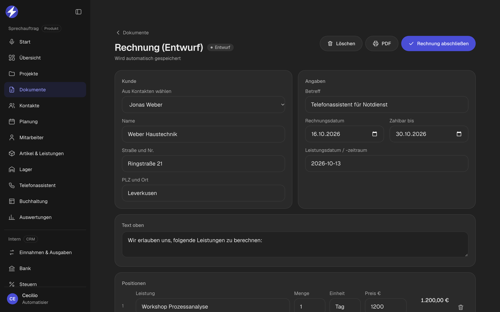
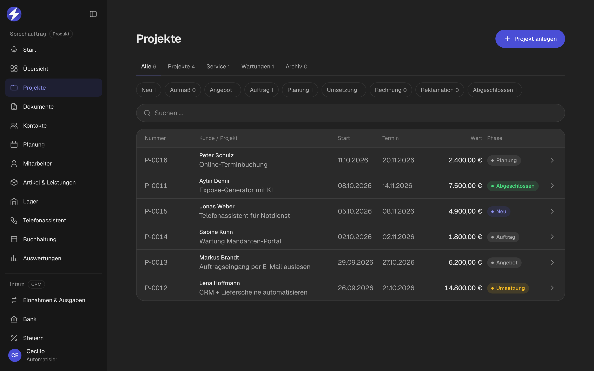
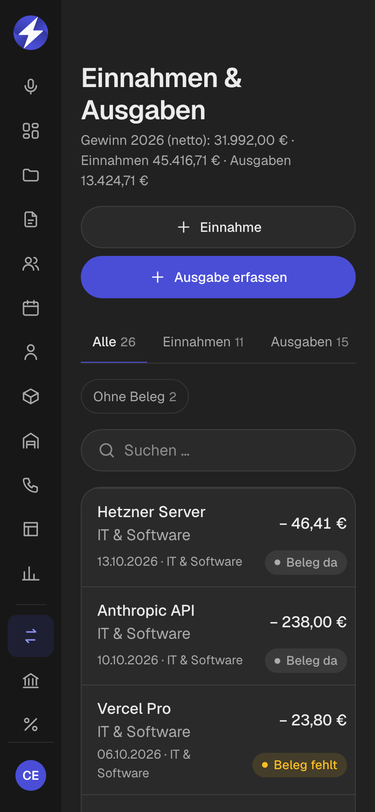

<div align="center">


# Automatisier CRM

**Eine Plattform für mehrere Firmen: CRM, Angebote, Rechnungen, Zeiterfassung, Buchhaltung, Steuern und Support.**
Jede Firma hat ihre eigenen Daten, ihre eigene Farbe und ihr eigenes Logo.




</div>

---

## Worum geht's?

Ich betreibe mehrere Firmen – eine Automatisierungs-Agentur, einen Sanierungsbetrieb und ein SaaS für Handwerker.
Statt für jede Firma eigene Tools zu bezahlen, läuft alles auf **einer** selbst gebauten Plattform:

- **Ein Login, alle Firmen** – oben links die Firma wechseln, Farbe und Logo passen sich an
- **Produkt-Bereich** (Angebote, Rechnungen, Projekte, Mitarbeiter) – das ist gleichzeitig die Software [Sprechauftrag](https://github.com/ciliooo/sprechauftrag), die Handwerker buchen können
- **Interner Bereich** nur für die eigenen Firmen: Einnahmen & Ausgaben, Bank, Steuern, E-Mail und Support-Cockpit

> Alle Screenshots zeigen **erfundene Demo-Daten**.

---

## Funktionen

### 📊 Buchhaltung



- Einnahmen und Ausgaben mit **Gewinn (netto)** fürs laufende Jahr
- **Beleg-Upload** (Foto oder PDF), Filter „Ohne Beleg“ zeigt, was noch fehlt
- Bezahlte Rechnungen werden automatisch als Einnahme gebucht

### 🧾 Steuern & Bank

| Umsatzsteuer-Voranmeldung | Bank-Abgleich |
|:---:|:---:|
|  |  |

- **Umsatzsteuer-Voranmeldung** monatlich oder vierteljährlich, mit den **ELSTER-Kennzahlen** zum Eintragen
- **Export für den Steuerberater** als CSV
- **Kontoauszug als CSV hochladen** – die App schlägt passende Rechnungen vor und verbucht mit einem Klick

### 📄 Angebote, Rechnungen & Projekte



- Angebote und Rechnungen mit Leistungskatalog, PDF und fortlaufenden Nummern
- Rechnung abschließen → festgeschrieben, danach nur noch Storno möglich
- Projekte mit Phasen von „Neu“ bis „Abgeschlossen“



### ⏱️ Mitarbeiter & Zeiterfassung


- Eigene **Stempel-App** für Mitarbeiter: Firmen-Code, Name, PIN – ein Knopf zum Ein- und Ausstempeln
- Pausen, Standort beim Einstempeln, Monatszeiten pro Mitarbeiter
- Schutz gegen PIN-Raten

### 🛟 Support-Cockpit & Hilfe-Center


- Jede Firma meldet Fehler, Fragen und Wünsche direkt im **Hilfe-Center**
- Im **Support-Cockpit** laufen alle Meldungen aller Firmen zusammen – mit Status und Dringlichkeit

### ✉️ E-Mail

- Eigenes **Postfach pro Firma** (IMAP/SMTP) direkt in der App
- Zugangsdaten verschlüsselt in der Datenbank gespeichert

### 📱 Handy zuerst



Jede Seite ist fürs Handy gebaut und lässt sich als App installieren.

---

## Aufbau

```
Plattform (eine Codebasis)
├── Mandanten (Firmen)      eigene Daten, Farbe, Logo, Module an/aus
├── Produkt                 = Sprechauftrag (für Kunden buchbar)
│   ├── Übersicht, Projekte, Dokumente, Kontakte
│   ├── Mitarbeiter + Stempel-App
│   └── Artikel & Leistungen
└── Intern                  nur eigene Firmen
    ├── Einnahmen & Ausgaben, Bank, Steuern
    ├── E-Mail
    └── Support-Cockpit
```

## Technik

- **Frontend:** Vanilla JavaScript, HTML, CSS – kein Framework, kein Build-Schritt
- **Backend:** Supabase (Postgres, Auth, Storage), Rechenzentrum **Frankfurt**
- **Sicherheit:** Row Level Security – jede Firma sieht nur ihre eigenen Daten, auch wenn jemand am Frontend vorbeigeht
- **Serverless:** Vercel Functions für E-Mail (IMAP/SMTP)
- **Design:** ein Design für alle Firmen, Farben und Logo kommen aus Design-Tokens pro Marke

## Geplant

Planung mit Kalender und Plantafel · Mahnungen · Rechnung per E-Mail mit PDF · Angebot per Sprache · ELSTER direkt senden · automatischer Bank-Abruf · Auswertungen

---

<div align="center">

Gebaut von **[Automatisier](https://automatisier.de)** – individuelle Automatisierung für Firmen · Der Quellcode ist privat.

</div>
